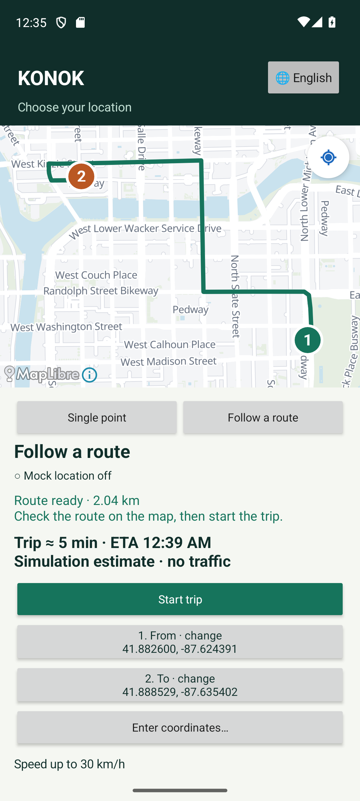

# Konok: Location Testing for Android Developers

**Android developers can test location-based apps from one device. Konok lets them choose a fixed point or simulate a trip between two addresses at a speed they select.**

[Google Play](https://play.google.com/store/apps/details?id=app.konok) · [Product website](https://konokapp.com/)

| Project | Details |
| --- | --- |
| **Status** | Live on Google Play |
| **My role** | Independent developer of the Android app, including maps, routing, subscriptions and localization |
| **Stack** | Java, Android SDK, MapLibre, OpenStreetMap, Google Play Billing |

This 2.04 km example in downtown Chicago shows both endpoints, the estimated trip time and the control that starts the simulation.

## What it does

- **Fixed point or full route.** Testers set a single location or simulate a trip between two addresses, with speed control plus pause and resume along the way.
- **Three ways to choose a place.** Enter coordinates, search for an address, or reuse a favorite saved on the device.
- **Route preview.** Shows distance and estimated travel time at the chosen speed before the simulation starts.

## What I built

- **Native Android app in Java.** MapLibre renders the map, and the route planner uses OpenStreetMap road data.
- **Subscriptions.** Monthly and annual plans for simulation through Google Play Billing.
- **Localization.** English, Russian and Spanish, plus a choice of miles or kilometers.

## Skills demonstrated

Java · native Android · maps (MapLibre) · OpenStreetMap routing · in-app subscriptions · localization · Google Play release

> This repository is a public showcase. The production source code is private.
